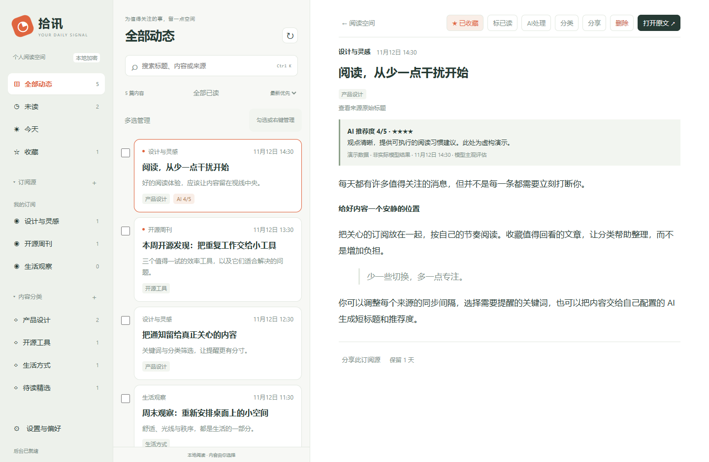
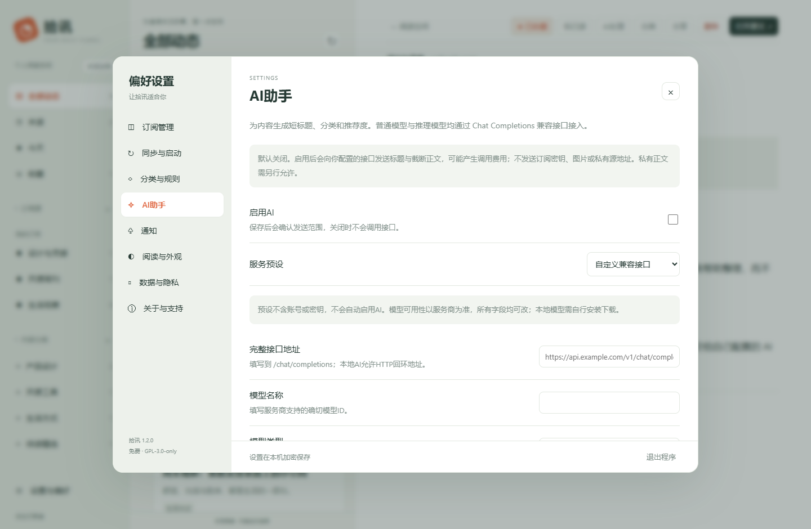

# 拾讯 Shixun

**把订阅、阅读和提醒，放进一个安静的 Windows 托盘应用。**

[](https://github.com/henryZhouLikeStudy/shixun/actions/workflows/build.yml)
[](https://github.com/henryZhouLikeStudy/shixun/releases/latest)
[](LICENSE)

免费的 Windows RSS / Atom 阅读与图文通知客户端。支持私有订阅、自定义分类、批量整理，以及可选的 AI 短标题、分类和推荐度。默认空订阅，AI 默认关闭。

**[下载 Windows x64 便携版](https://github.com/henryZhouLikeStudy/shixun/releases/latest)** · [更新记录](CHANGELOG.md) · [反馈问题](https://github.com/henryZhouLikeStudy/shixun/issues) · [隐私说明](SECURITY.md)



*截图全部使用离线虚构数据，AI评级也是演示，不包含真实用户订阅。*

## 三步开始

1. 下载便携包并**完整解压**至固定目录，运行 `Shixun.exe`。
2. 打开「设置 → 订阅管理」，添加 RSS / Atom 地址，或导入 OPML。私有来源保存后配置「请求与凭据」。
3. 在「同步与启动」设置同步频率和开机自启，在「通知」选择全部提醒或关键词／分类筛选。

需要 Windows 10/11 x64、.NET Framework 4.8 和 [Microsoft Edge WebView2 Runtime](https://developer.microsoft.com/microsoft-edge/webview2/)。关闭窗口后继续在托盘运行，右键托盘图标可退出。

## 能做什么

| 场景 | 功能 |
| --- | --- |
| 专注阅读 | 三栏独立滚动、紧凑标题、富文本链接、图片放大、深色模式与大字号 |
| 整理信息 | 自定义分类与规则、搜索、收藏、勾选／右键批量操作、删除确认与整体撤销 |
| 控制提醒 | 图文浮窗、关键词／分类筛选、免打扰、限频和稍后提醒 |
| 私有订阅 | 每源独立认证、多参数、自定义请求方式、DPAPI本机加密 |
| AI 辅助 | Kimi、GLM、DeepSeek、硅基流动、Ollama预设及自定义兼容接口 |
| 自主管理 | 每源同步间隔、规则文件更新预览、OPML迁移、正文定期清理 |

## 批量整理

勾选列表左侧复选框，或在文章卡片上右键打开管理面板。支持全选当前筛选结果、标已读／未读、收藏／取消收藏、手动分类锁定、15分钟后提醒、删除。

- 切换来源或分类时保留已选内容，面板显示跨筛选的总选择数量；可随时清空选择。
- 批量删除遵循「设置 → 数据与隐私 → 删除前确认」，删除后10秒内可整体撤销；下一次删除会替换撤销记录。
- 列表上方「全部已读」仅处理当前来源、分类和搜索条件下的结果。
- 「全选当前筛选」包括未在前500条列表中显示的匹配结果，请核对数量。

## 订阅与认证

设置中添加 RSS / Atom 地址；公开订阅无需认证。私有订阅先保存来源，再点“请求与凭据”。每个订阅源和规则源独立配置，支持 GET / POST、Bearer、Basic、自定义请求头、查询参数、路径占位、表单和 JSON 请求体。可组合多个参数。路径占位为 `{参数名}`；表单字段优先于原始请求体。认证值仅在原生窗口编辑，保存在当前 Windows 用户的 DPAPI 加密数据中，不经网页持久化。

带凭据请求要求 HTTPS（回环地址仅供本地测试），带凭据的跨站重定向会被拒绝。请直接填写最终地址。更换来源地址会清除旧认证，需重新配置。通用静态认证不等于自动 OAuth 登录；需要周期签名、验证码、动态Token换取的服务需要用户更新参数，不宣称支持所有私有API。

## 功能

- 详情标题默认最多两行，完整来源标题折叠查看，“打开原文”固定在详情右上角。
- 可选AI助手：兼容Chat Completions接口，普通/推理模型，生成短标题、现有分类和1—5星推荐度；默认关闭，私有内容单独授权。

- RSS 2.0 / RSS 1.0 / Atom，正文链接、图片、内容标题；网站声明的订阅地址发现。
- 每源与全局自定义同步间隔、条件请求、失败退避、手动同步、首次导入通知基线。
- 自定义分类、关键词、排除词、带超时的高级正则、规则排序、手动锁定与重分类。
- 本地或 HTTP(S) JSON 规则、GitHub 文件，预览后应用；自动检查不自动覆盖本地分类。
- 全部或按关键词/分类通知，自定义带图浮窗、系统提醒、免打扰、合并限频及稍后提醒。
- 搜索、已读、收藏、删除确认与撤销、来源分组、可折叠导航、深色与字号设置。
- OPML 导入导出、公开配置备份恢复；默认排除私有地址和认证。分享前必须确认路径本身不含密钥。
- 默认保留1天正文，可自定义；收藏豁免需启用；仅ID去重标记保留90天，数量有上限。

## 隐私与边界

develop开发版会在订阅管理中分别显示客户端同步时间与来源提供的云端缓存采集时间（可选响应头 `X-Feed-Updated-At`）；缓存采集超过15分钟时提示数据较旧。来源未提供该响应头时显示本机最新文章时间。HTTP请求成功不代表上游抓取成功，也不代表作者一定发布了新内容。

数据目录为 `%LOCALAPPDATA%\Shixun`，应用状态整体 DPAPI 加密、原子写入并保留上次加密备份。请勿将数据目录上传 GitHub。每用户加密不防止同一Windows账号下的恶意程序；请保护电脑账号。

客户端不提供内容抓取服务，不附带他人后台或访问权限。图片经原生层按需获取；仅同站图片可能使用来源凭据，跨站图片不传密钥；内容链接在默认浏览器打开。后台限流、源端分页、电脑休眠/断网会影响时效，不能保证秒级或完整历史。

自定义浮窗依赖程序运行，不自动进入Windows通知中心；全屏/游戏状态采用Windows通知状态检测与应用免打扰，检测失败保守抑制。通知记录在客户端内，过期正文不另存副本。系统通知模式采用Windows通知区域提醒，是否呈现由系统决定。

支持设置页迁移旧版客户端目录，凭据仅在本机解密，不上传。迁移后检查来源和自启，避免旧版与新版同时通知。安装目录与数据目录分离；不要在已设置自启后直接移动EXE。

## 构建和测试

下载并解压官方 `Microsoft.Web.WebView2` **1.0.4314.35** NuGet 包到 `.deps/WebView2`（或运行带SHA256校验的 `scripts/get-webview.ps1`），然后在PowerShell运行：

```powershell
.\build.ps1 -Test
```

亦可传 `-WebViewSdk` 指定已解压目录。系统 Framework64 C# 编译器构建，无需下载第三方业务代码。输出 `build/Shixun.exe`。对应版本源码在仓库标签和每次Release附件中提供。

## AI 接入

在「设置 → AI助手」选择服务预设，或自定义完整的 `https://你的服务/v1/chat/completions` 地址和服务商模型ID，选择普通或推理模式，保存后通过原生“AI密钥与参数”配置认证。支持Bearer、Basic或自定义认证头，密钥不保存在网页中。OpenAI原生Responses接口、Anthropic原生Messages接口不作为Chat Completions接口处理；使用提供兼容协议的地址。

推理模型的Token字段可选 `max_tokens` 或 `max_completion_tokens`，可选推理强度与 `thinking` 参数；不同服务商支持范围不同，默认不发送额外推理参数。模型超时、格式不符或输出截断时保留原文和已有结果，给出通用错误。程序不保存模型内部思考过程。

自动AI只处理首次同步基线后的新增内容，异步运行，不延迟RSS同步和即时通知；历史文章可在详情点击“AI处理”。通知首次到达可能仍使用本地缩短标题及规则分类，AI结果随后更新阅读界面，不重复通知。手动分类锁定优先于AI。AI结果有内容缓存，默认每日最多尝试30次（含失败），可配置；这不是货币费用上限。

首次启用会说明发送范围及可能费用。默认不发送私有订阅；微博等需明确开启“允许发送私有订阅正文”。只发送标题、截断纯文本与分类列表，不发送订阅凭据、图片和来源URL；纯文本中的HTTP(S)链接替换为占位。预设只包含接口与模型参数，不包含账号或密钥，保存后可用内置虚构示例测试。推荐度只是模型主观评价，不验证价格、优惠真实性或商品质量。

### 服务预设

| 预设 | 默认模型 | 说明 |
| --- | --- | --- |
| DeepSeek 普通／推理 | `deepseek-flash` | 分别关闭／开启thinking |
| Kimi 国内／国际 | `kimi-k3.1-pro` | 推理模式、low强度；按账号区域选接口 |
| GLM 旗舰／Flash | `glm-5.3` / `glm-5.3-flash` | 智谱通用开放平台接口 |
| 硅基流动 | `deepseek-ai/DeepSeek-V4-Flash` | Chat Completions兼容接口 |
| Ollama | `gpt-oss:20b` | 本机11434端口，需自行安装和下载模型 |
| 自定义 | 自行填写 | 所有预设字段也都可以修改 |

模型与接口参数按2026-11-12官方文档核对：[Kimi](https://platform.kimi.com/docs/models)、[Kimi思考模式](https://platform.kimi.com/docs/guide/use-thinking-models)、[GLM](https://docs.bigmodel.cn/cn/api/introduction)、[DeepSeek](https://api-docs.deepseek.com/quick_start/pricing/)、[硅基流动](https://docs.siliconflow.cn/docs/api/chat-completions-post)、[Ollama](https://docs.ollama.com/api/openai-compatibility)。可用模型、权限和费用以你的服务商账号为准；预设不代表已经使用真实付费账号逐一测试，也不包含Coding套餐专用端点。



## 常见问题

**需要一直开着窗口吗？** 不需要展开窗口，但提醒依赖程序常驻托盘。可开启登录Windows自动启动；电脑休眠或关机期间不会同步。

**能直接订阅微博主页吗？** 客户端接收RSS/Atom，微博等平台需要你自己有权访问的订阅转换服务；本仓库不提供抓取后台和共享密钥。

**AI 是必须的吗？** 不是。未启用时仍可同步、阅读、规则分类和通知。启用时才按授权发送文本，接口费用由你的服务商收取。

**更新会丢数据吗？** 退出托盘程序后，用新版便携包覆盖同一安装目录。用户数据单独存于当前账号的 `%LOCALAPPDATA%\Shixun`；不要覆盖或公开这个目录。

**为什么下载时提示未知发布者？** 当前EXE未做商业代码签名。请从本仓库Release下载，可对照附件SHA256校验文件。

## 规则文件格式

```json
{"version":1,"categories":[{"key":"technology","name":"科技","color":"#729178","keywords":["开源","技术"],"exclude":["广告"]}]}
```

最多1MB、100条分类；更新以规则源ID和key关联，只更新同源对应规则，不删除文件里已移除的分类；本地编辑会解除远程关联。GitHub blob链接会转换为Contents API，分支包含斜线时请直接填写正确的GitHub API或raw文件地址。私有规则需要在该规则源独立配置权限。

## 许可证

原创客户端采用 GPL-3.0-only，完整条款见 LICENSE，无担保。WebView2 SDK等组件保留独立许可，见 THIRD-PARTY-NOTICES.md。分发修改版时须提供匹配源码。软件许可不授予任何订阅内容、商标或数据接口的额外权利。
